# Registration results: a visual guide

A picture-by-picture walk through the two registration experiments. All pictures were produced by the team pipeline (`processing/`) or by the report charts.

- Numbers and details: HCC-TACE-Seg report · WAW-TACE report
- Open issues and fixes: CONCERNS_AND_SOLUTIONS.md

| | HCC-TACE-Seg | WAW-TACE |
|---|---|---|
| What is compared | The **same patient weeks apart**: before vs after TACE treatment | The **contrast phases of one visit**, minutes apart |
| Registered | 69 patients | 44 patients (114 phase pairs) |

---

## How to read the pictures

| In the picture | Meaning |
|---|---|
| Grey images | CT slices: horizontal cuts through the upper abdomen. **In these figures the liver is the large organ on the right-hand side** |
| Columns (lower / mid / upper, or inferior / centre / superior) | Three heights of the body, from lower to higher |
| Rows | One scan per row (a visit, or a contrast phase) |
| **Cyan line** | Liver outline |
| **Red area or red line** | Tumour outline |
| Bottom row with white background | **Difference picture**: follow-up minus baseline. **White** = no change, **red** = brighter in the follow-up, **blue** = darker |
| Very bright white tube in front of the spine | The aorta, filled with dye. Bright aorta = scan taken **with dye**; grey aorta = **no dye** |

A good registration gives a difference picture that is **white inside healthy liver**, with colour only where something really changed.

---

# Part A: HCC-TACE-Seg (before vs after treatment)

## A1. One patient through the whole pipeline (HCC_019)

### Step 1: prepare both visits and line them up roughly

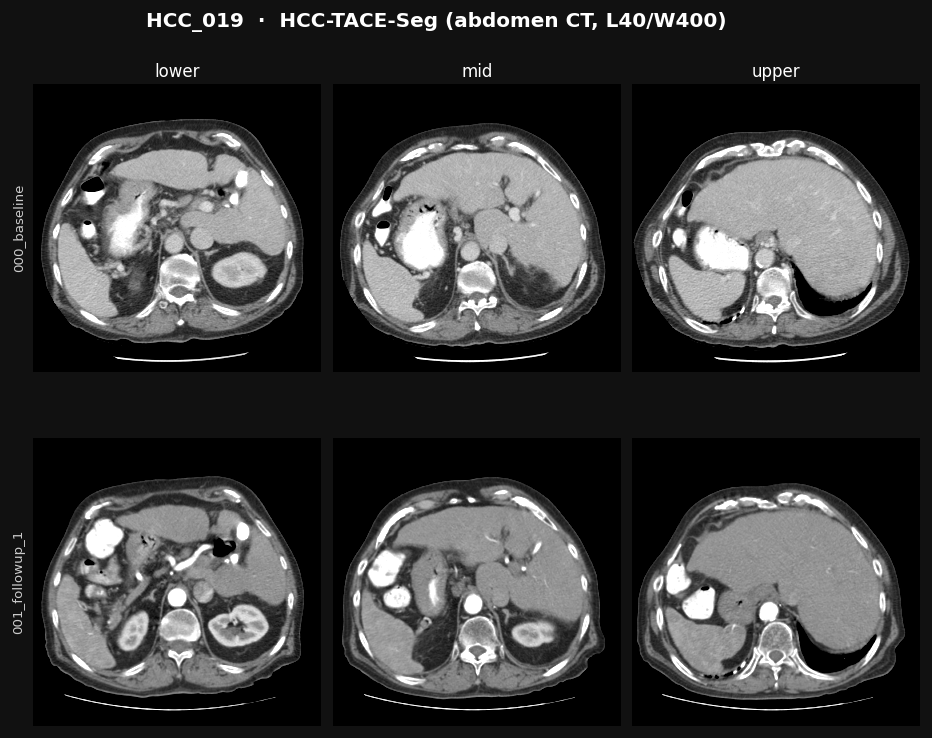

Top row: **before** TACE. Bottom row: **after** TACE, already slid and turned to match the first scan. The two rows show the same body levels, but the liver shape still differs slightly. That remaining difference is what the bending step removes later.

### Step 2: the radiologist's outlines (before scan only)

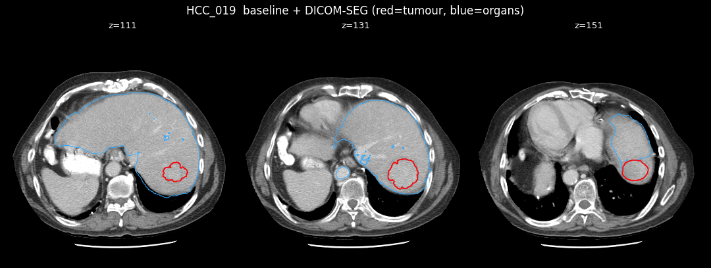

Blue: organs drawn by the radiologist (liver, portal vein, aorta). **Red: the tumour.** This is the reference for where the tumour really is.

### Step 3: CADS finds the organs automatically

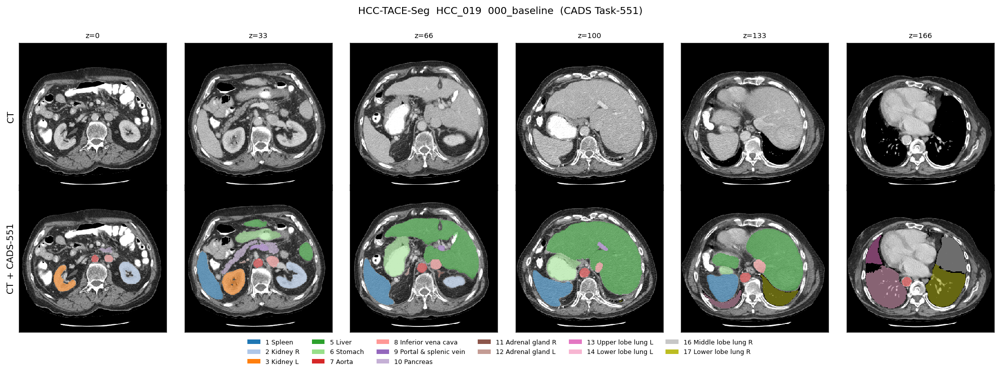

Top: the scan. Bottom: the same slices with every organ coloured (green = liver, blue = spleen, orange and light blue = kidneys, red = aorta). CADS does this for **every scan**. These organ shapes are what guides the bending in step 6.

### Step 4: SegVol finds the tumour automatically

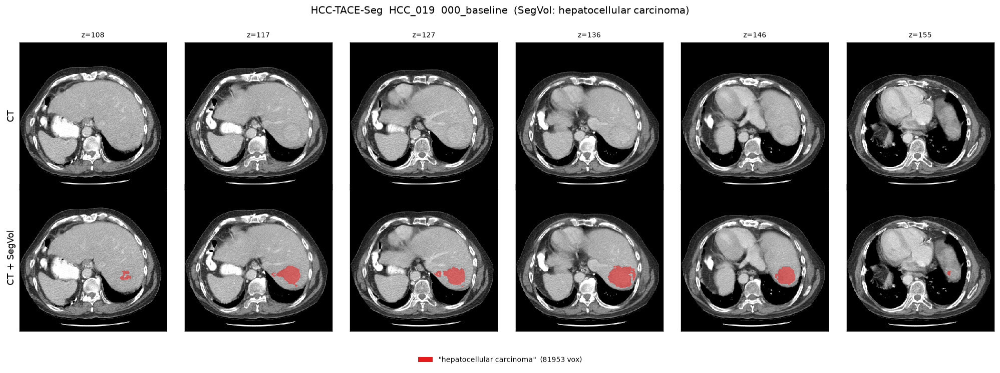

Red: where SegVol thinks the tumour is. For this patient it lies in the same place as the radiologist's red outline in step 2.

### Step 6: registration result

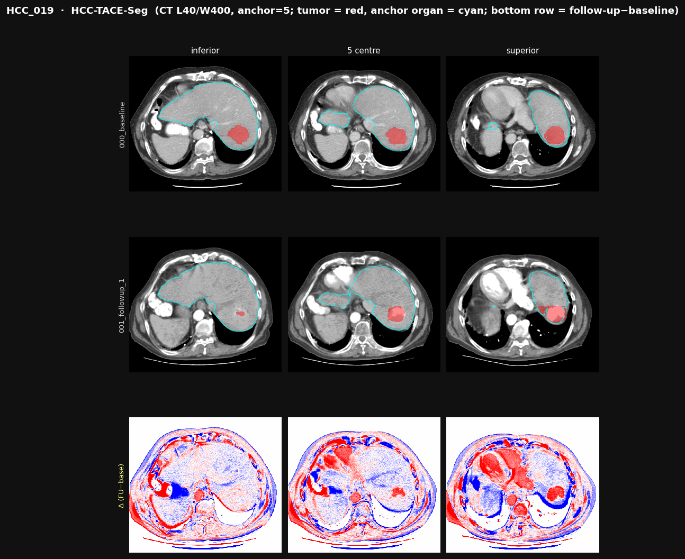

Rows: before, after (now bent to fit), and the **difference**.

- The cyan liver outline has the **same shape and position** in both scans.
- In the difference row the **liver is almost white**: healthy liver matches.
- The **tumour shows as a red patch**: a real change after treatment. This is the kind of signal HOPE wants.
- The heart and vessels are red because the dye was brighter at the second visit. That is a dye-timing difference, not misalignment.

Organ overlap for this patient: 0.77 after slide and turn → **0.88** after bending.

---

## A2. The main problem in pictures: scan with dye vs scan without dye (HCC_001)

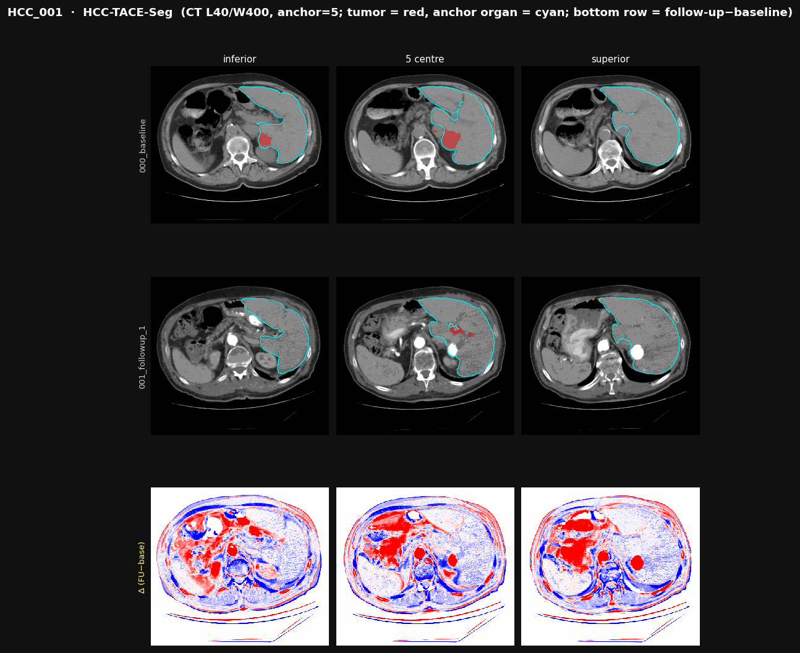

- **Before (top row):** the aorta is **grey**: this scan has **no dye**.
- **After (middle row):** the aorta and kidneys are **bright white**: this scan **has dye**.
- **Difference (bottom row):** large red areas (aorta, kidney, vessels, bowel) that are **not real changes**. They are only the dye.

The liver outlines line up, so the **alignment worked**. But the difference picture is flooded by dye, which could hide a small tumour or look like one. This happened because the pipeline picks the scan with the most slices at each visit, without checking the dye. In 29 of 69 patients at least one of the two scans had no dye.

---

## A3. The worst patient (HCC_012)

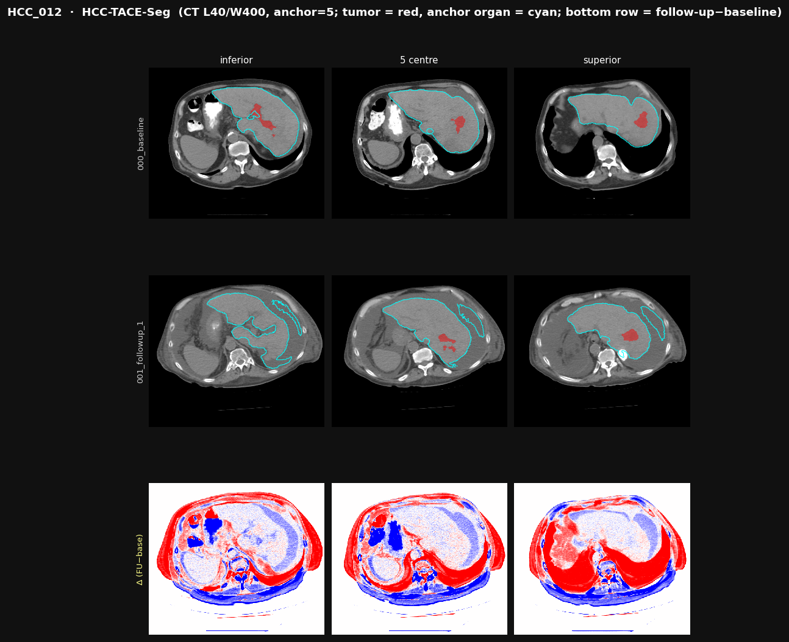

Both scans have little or no dye, and the **body outline differs strongly** between the visits: the thick red band around the body. The liver centre is roughly aligned, but the difference picture is dominated by body-shape and brightness differences. Organ overlap: 0.19 → 0.51, the lowest of all patients.

---

## A4. The stacked-phase problem and its fix (HCC_002)

Some scan folders hold **two contrast phases mixed together**. Read as one scan, the body appears twice.

**Before the fix** (front view of the scan): the liver and kidneys appear **twice**, one copy above the other.

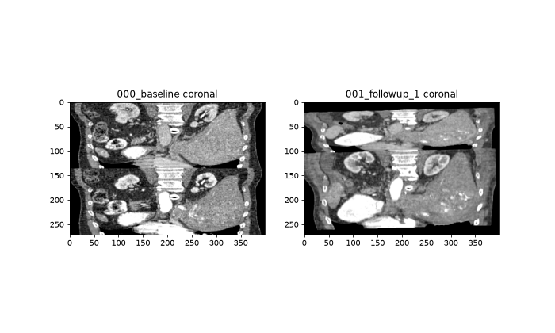

**After the fix:** one phase is used and the anatomy is correct.

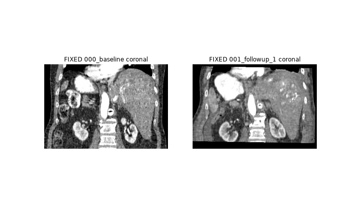

**Registration of the same patient with the fix:**

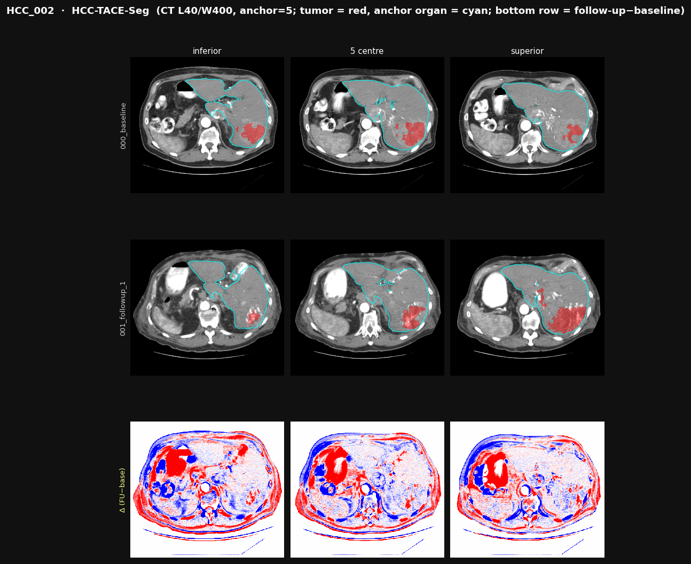

Both rows show a **bright aorta**: the same dye phase was chosen at both visits (aorta 332 vs 335 HU). The liver is well aligned and mostly white in the difference row. The remaining red and blue areas are the stomach and bowel, whose contents really differ between visits. Organ overlap: **0.77** (without the fix, in the pilot: 0.37).

---

## A5. All 69 patients at a glance

### Scores before and after bending

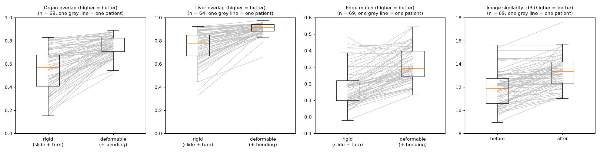

Each grey line is one patient: the left end is after slide and turn, the right end after bending. **Almost every line rises.** Liver overlap goes from 0.78 to **0.91** (median).

### What the pipeline's self-checks reported

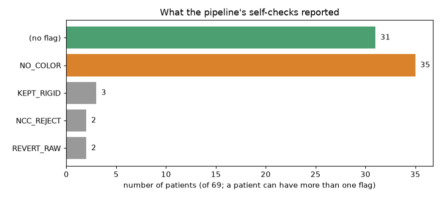

In **35 of 69** patients the brightness could not be evened out (`NO_COLOR`), the dye problem of section A2. Only 7 patients kept a simpler result (`KEPT_RIGID`, `NCC_REJECT`, `REVERT_RAW`).

### The dye mismatch does not hurt alignment, but hurts comparison

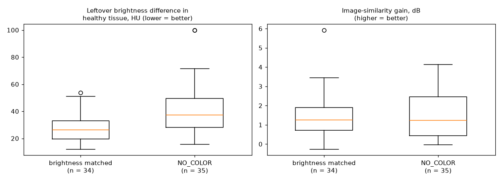

Left: patients flagged `NO_COLOR` keep more brightness difference in healthy tissue (37 vs 26 HU).

---

# Part B: WAW-TACE (contrast phases of one visit)

## B1. One patient's four phases (patient 58)

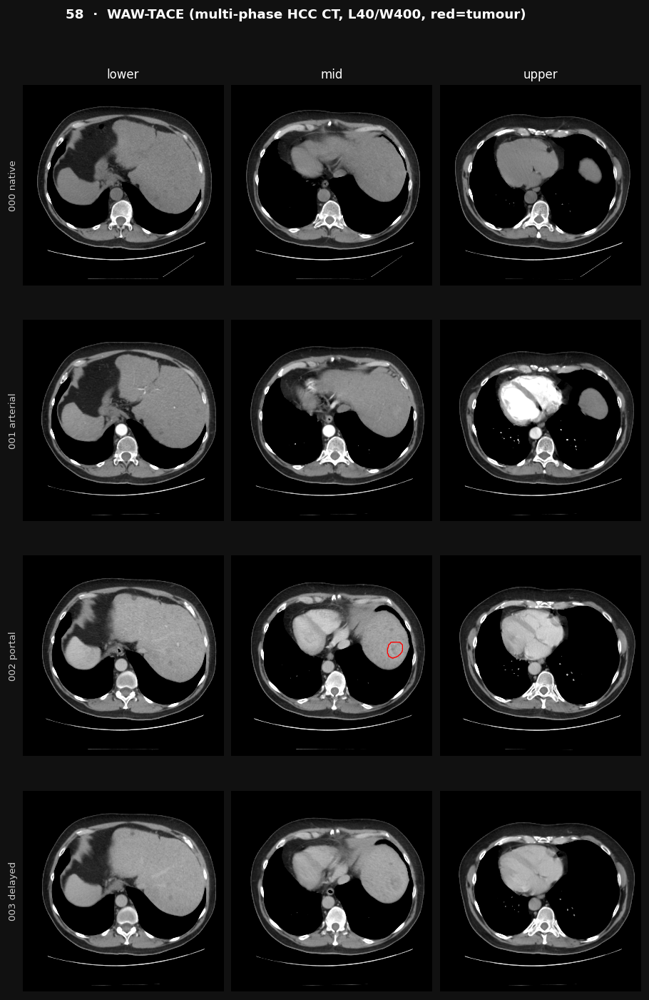

Four scans taken within minutes, after step 1 (slide and turn only):

| Row | Phase | What to notice |
|---|---|---|
| 1 | No dye | Aorta grey; everything a similar grey |
| 2 | Arterial | **Aorta and heart bright white**; liver still fairly dark |
| 3 | Portal venous | **Liver brighter**; the radiologist's tumour outline (red) is drawn on this phase |
| 4 | Delayed | Dye fading; everything mildly bright |

The same liver looks different in every row. That is the dye, not a change in the patient. The "mid" column also shows that the rows are **not yet at exactly the same body level** (rows 3–4 sit higher, with the heart visible): slide and turn alone was not enough here.

## B2. Registration result: a good example (patient 58)

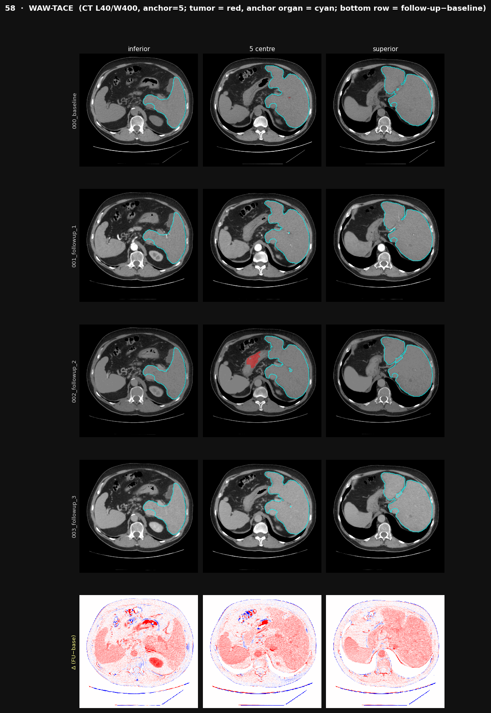

After bending, all four rows show the **same body level** and the cyan liver outline has the **same shape in every phase**. Organ overlap for no dye → arterial: 0.67 → **0.94**.

The difference row (delayed minus no dye) is **evenly pink over the liver and spleen**. That is the **dye itself**: everything with blood supply became brighter. There are no sharp red or blue edges, which is the sign of good alignment.

(The red area near the centre of the third row is a SegVol tumour outline that landed outside the liver.)

## B3. Registration result: the worst example (patient 33)

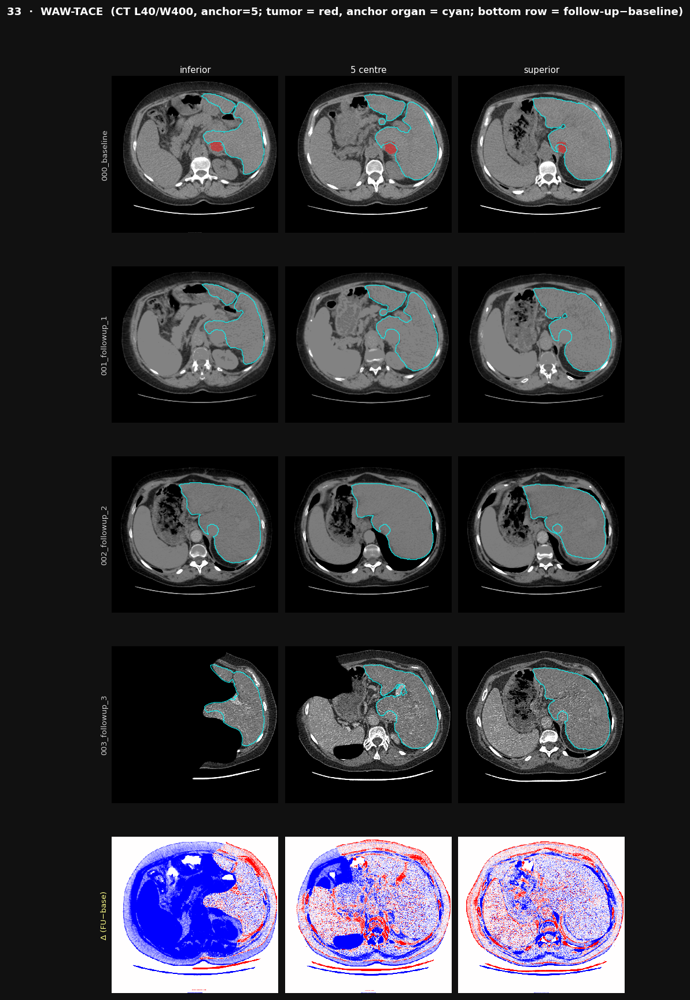

The delayed scan (fourth row) covers **only part of the body**: in the left column most of the body is missing. The body position also differs between phases. The difference row is dominated by **missing and shifted body areas**. Organ overlap for no dye → portal: **0.40**; the safety checks rejected the bending.

---

## B4. All 114 phase pairs at a glance

### Scores

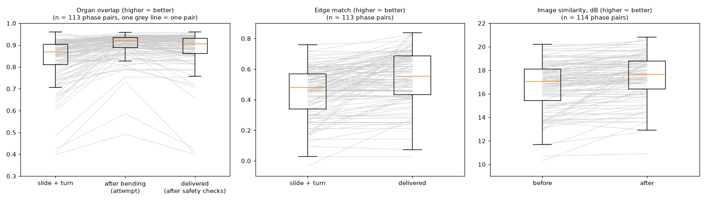

Left chart: organ overlap after slide and turn (0.87), after the bending attempt (0.92), and what was **delivered** after the safety checks (0.91). The scans are already well aligned before bending, because they were taken minutes apart.

### What the pipeline's self-checks reported

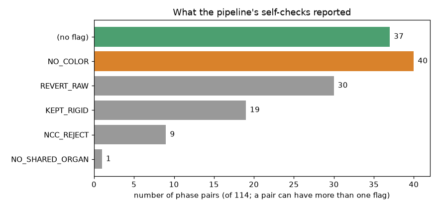

The safety checks kept the unbent scan in about half of the pairs (`REVERT_RAW`, `KEPT_RIGID`, `NCC_REJECT`): with scans this close, bending has little to gain. `NO_COLOR` (40 pairs) is expected here, because the phases differ in dye by design.

### Results per phase pair

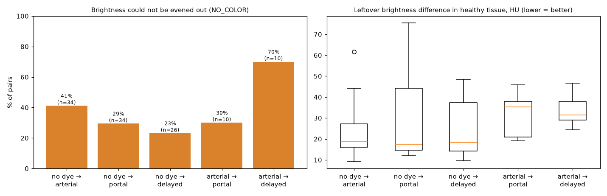

Pairs between **two dye phases** (arterial → portal or delayed) keep about twice the brightness difference (32–35 HU) of pairs against the no-dye scan (17–19 HU).

---

# Part C: what the pictures show together

| Observation | Seen in |
|---|---|
| The pipeline **lines up the liver well**, weeks apart and within one visit | A1 (HCC_019), A4 (HCC_002), B2 (patient 58), charts A5 and B4 |
| **Dye differences alone** change the picture strongly, even with good alignment | A2 (HCC_001: dye vs no dye), B1 and B2 (patient 58: phases) |
| So for comparing visits, **both scans must be in the same dye phase** | A4 (HCC_002: same phase chosen, clean liver) vs A2 (HCC_001) |
| The worst cases are scans that **cover different parts of the body** or differ in body shape | A3 (HCC_012), B3 (patient 33) |
| Real treatment change **is visible** when the scans are comparable | A1 (HCC_019: tumour as a red patch) |
